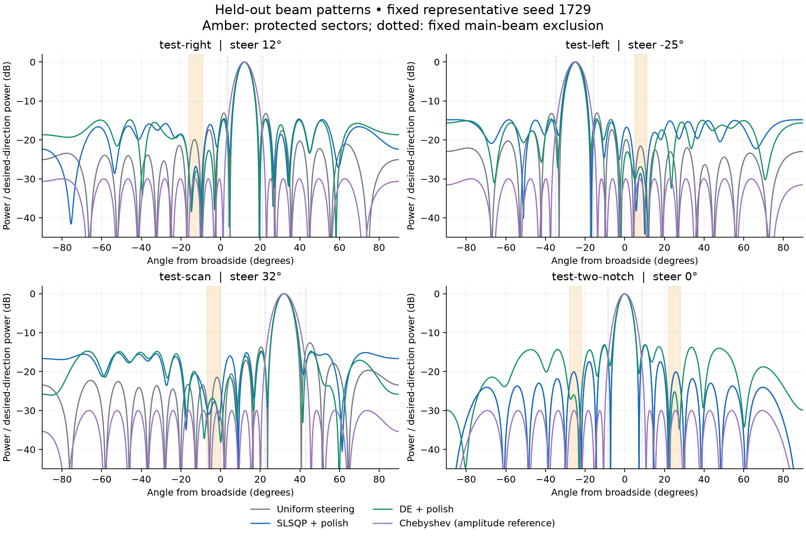
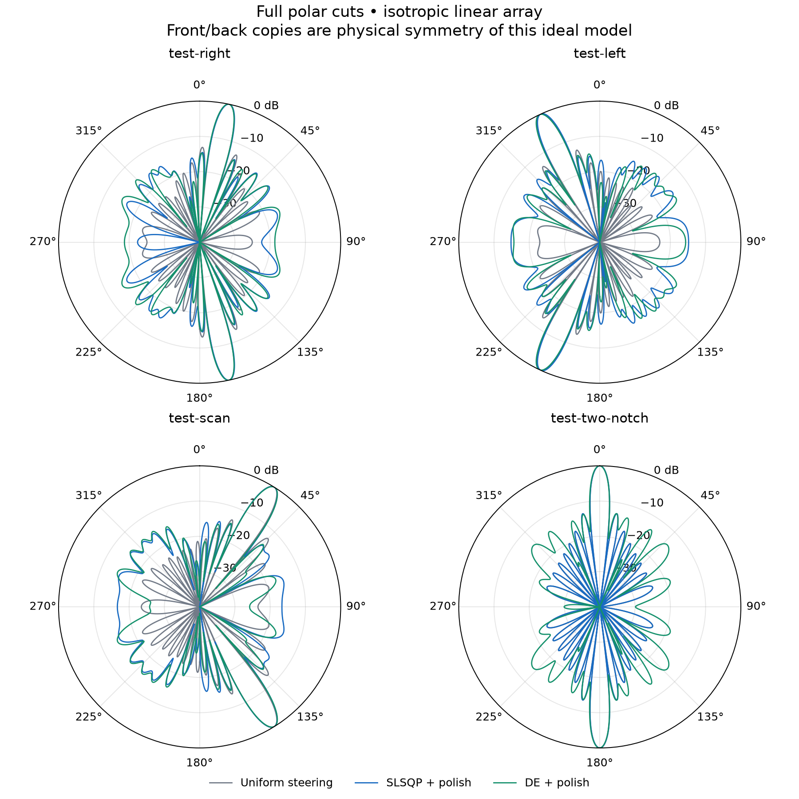
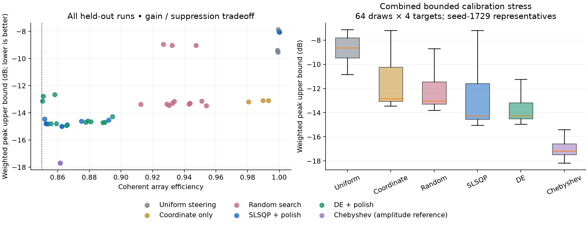

# Antenna array beam-pattern pilot — results

Local, author-checked simulation evidence. No maintainer acceptance, hardware result, global optimum, or algorithmic novelty is claimed. Model: 16 isotropic elements, half-wavelength spacing, 3 GHz, equal amplitude and 6-bit phase control. See [model and bounds](MODEL.md), [frozen experiment](EXPERIMENTS.md), and [literature audit](LITERATURE.md).

## Held-out comparison

The primary score is max(global fixed-mask sidelobe power, 16 × protected-sector peak power), divided by desired-direction power. Lower dB is better. The table reports medians over three seeds for SLSQP, DE and random search, and one deterministic run for the other methods. Chebyshev uses amplitude freedom and is outside the hardware class.

| Target | Uniform | Coordinate | Random | SLSQP | DE | Chebyshev reference |
|---|---:|---:|---:|---:|---:|---:|
| test-right | -7.88 | -13.19 | -13.15 | -14.61 | -14.72 | -17.70 |
| test-left | -9.54 | -13.10 | -13.36 | -14.80 | -14.66 | -17.70 |
| test-scan | -9.39 | -13.09 | -13.35 | -14.99 | -14.70 | -17.70 |
| test-two-notch | -8.06 | -8.06 | -9.03 | -8.06 | -12.77 | -17.70 |

| Method | Mean weighted improvement vs steering (dB) | Mean sector improvement (dB) | Mean global SLL improvement (dB) | Nominal feasible | Combined-stress feasible |
|---|---:|---:|---:|---:|---:|
| Uniform steering | -0.00 | -0.00 | -0.00 | 4/4 | 256/256 |
| Coordinate only | 3.14 | 3.40 | 0.15 | 4/4 | 256/256 |
| Random search | 3.52 | 4.20 | -0.30 | 12/12 | 256/256 |
| SLSQP + polish | 4.37 | 4.75 | 1.37 | 12/12 | 239/256 |
| DE + polish | 5.51 | 5.95 | 1.25 | 12/12 | 222/256 |
| Chebyshev (amplitude reference) | 8.98 | 9.23 | 4.71 | 4/4 | 256/256 |

## Best feasible local constructions

These are best-of-portfolio witnesses, separate from the all-seed comparison. Directivity is the ideal scalar-model target directivity, not realized hardware gain. Excitation tables are in `results/best-phases.csv`.

| Target | Method / seed | Coherent efficiency | HPBW (degrees) | HPBW (u) | Target directivity | Main-region power fraction |
|---|---|---:|---:|---:|---:|---:|
| test-right | de / 2718 | 0.8655 | 6.681 | 0.11407 | 13.848 | 0.8111 |
| test-left | slsqp / 1729 | 0.8539 | 7.149 | 0.11321 | 13.662 | 0.8003 |
| test-scan | slsqp / 1729 | 0.8626 | 7.753 | 0.11454 | 13.801 | 0.8127 |
| test-two-notch | de / 1729 | 0.8505 | 6.400 | 0.11164 | 13.608 | 0.7865 |

Improvements compare baseline **lower** bounds to candidate **upper** bounds. A negative value means degradation, including the tiny negative self-comparison caused by enclosure width. Gains are averaged over all method runs, pairing each run with the same target baseline. The four cases are not a statistical sample of all array applications.

The largest nominal sidelobe/sector enclosure width across held-out witnesses was 0.00784 dB. Beamwidth and pointing checks remain numerical, and the curvature bounds use float64 rather than directed rounding.

## Before / after patterns

## Calibration sensitivity

The stress trials perturb phases by up to 2°, along-array positions by up to 0.005 wavelength (about 0.50 mm), and amplitudes by up to 3%, both separately and together. Errors are independent uniform draws; all methods see the same 64 draws. Representatives were fixed to seed 1729 before outcomes, not chosen for favorable robustness. Bounds on each trial use a different density-2049 grid. Feasible counts include gain, width and pointing limits. These finite trials do not guarantee fabrication yield.

| Target / method | Nominal representative | Combined stress median | Combined stress 95th percentile | All-error-box upper bound |
|---|---:|---:|---:|---:|
| test-right / uniform | -7.88 | -7.86 | -7.18 | -1.18 |
| test-right / slsqp | -14.53 | -13.84 | -13.05 | -3.62 |
| test-right / de | -14.72 | -14.50 | -13.98 | -3.93 |
| test-left / uniform | -9.54 | -9.61 | -8.79 | -1.99 |
| test-left / slsqp | -14.82 | -14.47 | -14.22 | -4.01 |
| test-left / de | -14.60 | -14.35 | -13.40 | -3.61 |
| test-scan / uniform | -9.39 | -9.35 | -8.64 | -1.92 |
| test-scan / slsqp | -14.99 | -14.69 | -13.60 | -3.82 |
| test-scan / de | -14.70 | -14.30 | -13.11 | -3.65 |
| test-two-notch / uniform | -8.06 | -7.75 | -7.31 | -1.27 |
| test-two-notch / slsqp | -8.06 | -7.75 | -7.31 | -1.27 |
| test-two-notch / de | -13.13 | -12.85 | -11.90 | -2.95 |

The all-error-box bound follows a triangle-inequality field enclosure, not Monte Carlo. It is deliberately conservative and does not establish beamwidth or pointing robustness. Nominal designs close to the 0.85 gain floor can fail that floor under small calibration errors. That is a reason to optimize with margin or a robust objective before engineering use.

## Cost and reproducibility

| Method | Median objective evaluations | Median search seconds |
|---|---:|---:|
| coordinate | 98 | 0.007 |
| random | 10306 | 0.683 |
| slsqp | 776 | 2.964 |
| de | 10338 | 2.030 |

Timing is descriptive on this host; background load was not controlled. Analytic-gradient SLSQP and population search have different budgets, so this is not an equal-cost efficiency ranking. DE and nonadaptive random search have matched core proposal counts; both intelligent methods use the same discrete polish. Stored witnesses can be checked without rerunning optimization. All phases, amplitudes, seeds, solver diagnostics, configuration hashes, and environment versions are retained.

## Discovery yield and engineering relevance

The useful output is a verified benchmark, feasible phase tables, measured tradeoffs, and a discriminating negative case. On the two-sector broadside target, this SLSQP procedure returns the steering pattern for every seed, while DE finds a better discrete configuration. This supports keeping a global-search comparator; it does not show that all local or manifold methods fail. On easier targets, cheap coordinate changes already recover much of the improvement, so the extra benefit of sophisticated optimization must be compared against that baseline.

The experiment shows that constrained phase configuration can improve protected-sector rejection in an ideal array while retaining prescribed nominal gain, width and pointing. The amplitude reference illustrates the cost of equal-amplitude hardware. Robustness checks expose limited gain margin in some optimized configurations. Those observations have engineering meaning for phase-shifter resolution and calibration budgets, but no coupling, element pattern, amplifier, feed, polarization or measurement model is present. There is no hardware performance claim.

Scientific novelty yield is unestablished. DE, constrained minimax synthesis, phase-only notching and Chebyshev tapering all predate this pilot. The benchmark is too small and lacks a modern manifold/ADMM comparator or rigorous optimization lower bound to claim a new frontier. A promising next step is robust quantized synthesis with explicit gain margin, a larger untouched target set, nonisotropic embedded-element patterns, and a convex or gridless lower-bound comparison. A maintainer and independent review are still needed before opening donor intake.
