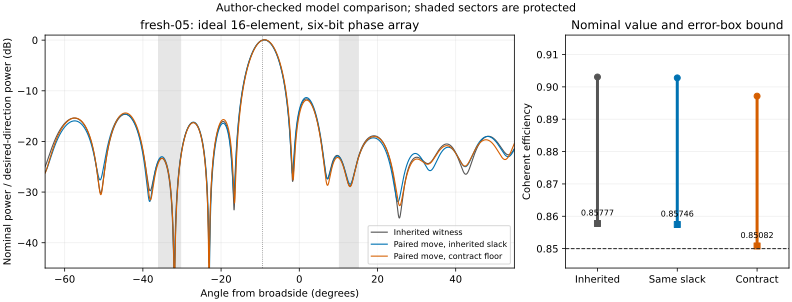

# fresh-05: a bounded calibration-margin improvement

The proposed six-bit phase witness reduces the weighted off-target peak from an
inherited enclosure of **[-10.924414, -10.922421] dB** to
**[-11.230472, -11.228319] dB**. Its analytic coherent-efficiency error-box lower
bound is **0.8508185**, above the task's 0.85 requirement. The candidate upper
bound beats the inherited lower bound by **0.303905 dB** (at least 6.758% in the
weighted power ratio, subject to the evaluator's float64 limitations).

This is **author-checked numerical model evidence** on an exposed development
case. It is not a global optimum, a literature record, independent scientific
acceptance, or a hardware result. The frontier, evaluator, original experiment
configuration, and inherited results are unchanged.



## Scope and provenance

- Task: `fresh-05-calibration-margin`, selected by the project's own picker.
- Donation and task seed: `35ab2889d636ae8978598a15aa094cc6`.
- Base commit: `d9db8b4f07222da18b89cd4a936cbcf5e915925f`.
- Starting witness: `fresh-05__margin-hybrid__905` in the
  [prepared portfolio](../readiness-20261021/portfolio.json).
- Coordination: [claim in Handoffs](https://github.com/discoveryathome/antenna-array/discussions/3#discussioncomment-19129449).
- The model and feasibility gates are from [MODEL.md](../../docs/MODEL.md),
  [the task instructions](../readiness-20261021/README.md), and
  [the inherited coherence bound](../../trial/MATH.md).
- AI agent implementation, experiments, and author checks, under a donor's grant.
  The original project authors supplied the model, evaluator, inherited witness,
  and calibration inequality; no coauthorship is implied.

The array remains 16 fixed half-wavelength isotropic elements at 3 GHz, with
unit amplitudes and 64 possible phases. The target points at -9.409482662 degrees
and has the same two protected sectors as the inherited task. No frozen held-out
target was used for tuning.

## Experiment and interpretation

Each descent starts from the inherited witness and examines every alternate bin
on each individual element (1,008 alternatives). The paired phase then adds all
120 pairs of elements with each member moved by -2, -1, +1, or +2 bins, giving
2,928 alternatives per sweep including single moves. It accepts the best sampled
score reduction satisfying the specified nominal-efficiency floor and stops when
that finite neighborhood has no improving sampled move. There are no random
restarts or enlarged follow-up searches. The seed determines the hub and task
draw; the experiment itself is deterministic.

Two floors distinguish the move-set effect from the use of calibration margin:

1. **Inherited slack:** retain `required_nominal_eta(u0)` = 0.9014312546592688.
2. **Contract floor:** use its zero-slack inverse plus 1e-9 =
   0.8964312556592688, and independently require the actual error-box lower
   bound to remain at least 0.85. This removes the earlier optimizer's optional
   0.005 nominal-efficiency search slack; it does not lower the task's actual gate.

| Design | Weighted peak upper (dB) | Nominal efficiency | Error-box lower bound |
| --- | ---: | ---: | ---: |
| Inherited / inherited-slack singles | -10.922421 | 0.903041 | 0.857773 |
| Inherited-slack pairs | -10.974429 | 0.902773 | 0.857457 |
| Contract-floor singles | -10.954958 | 0.897224 | 0.850930 |
| Contract-floor pairs (proposed) | **-11.228319** | **0.897129** | **0.850819** |

The same-slack branch establishes a smaller 0.050015 dB improvement beyond the
inherited enclosure, so the entire result is not explained by spending the
optional margin. The strongest witness trades some of that margin for nominal
rejection. Its pointing error is 0.009273591 in direction cosine (limit 0.015),
and its half-power width is 0.113251908 (limit 0.14).

The final bins are `[26, 34, 33, 40, 45, 49, 51, 59, 2, 8, 10, 15, 21, 28, 22, 41]`.
Only elements 1, 3, and 5 (zero-based) differ from the inherited witness, each by
one bin. The proposed witness is [run-1/candidate.json](run-1/candidate.json).

The fixed search cap was 30 sweeps per stage and 30 minutes overall; all four
stages exhausted their neighborhoods after one or two sweeps. The recorded run
used 14,736 proposal evaluations and about 0.46 seconds of experiment execution
on this host. Setup, source audit, verification and reporting time are separate;
this is not a controlled speed comparison. Every attempted sampled score and
nominal efficiency is retained in [attempts.jsonl](run-1/attempts.jsonl), together
with each stage's base bins. [search-results.json](run-1/search-results.json)
records source hashes, limits, intermediate candidates, failures to improve,
environment versions, and the winning candidate.

## Reproduce and check

Install the repository's pinned `requirements.lock.txt` in a local virtual
environment. Commands below run from the repository root with that environment's
`python`. The recorded run used Python 3.13.5, NumPy 2.5.4 and SciPy 1.18.1.

```sh
python -m src.readiness check --task fresh-05-calibration-margin --candidate research/readiness-20261021/fresh-05-calibration-margin.json
OPENBLAS_NUM_THREADS=1 OMP_NUM_THREADS=1 PYTHONPATH=. python research/donation-35ab2889/search.py --output /tmp/antenna-35ab2889-replay
python -m src.readiness check --task fresh-05-calibration-margin --candidate research/donation-35ab2889/run-1/candidate.json
OPENBLAS_NUM_THREADS=1 OMP_NUM_THREADS=1 PYTHONPATH=. python research/donation-35ab2889/verify.py --output /tmp/antenna-35ab2889-verification.json
```

Choose a fresh output directory when replaying. The saved candidate can be
checked without rerunning the search. The author replay reproduced the same
four candidates, histories, and attempted scores exactly on this environment.
The replay script requires exact agreement, so numerical differences on another
platform can fail that stronger check even if the candidate verifier passes.

Author checks, recorded in [verification.json](verification.json):

- The unmodified task checker reports `established_improvement: true`.
- A separate complex-field implementation evaluates 100,001 uniformly spaced
  angles per region and refines derivative sign changes with Brent root finding.
  Its peak values for the inherited and all four stage outputs fall inside the
  official continuous-angle enclosures.
- A 64-bit-mantissa extended-precision rearrangement of the calibration bound
  returns 0.85081852341797344476.
- Wrong target, nonquantized phase, altered amplitude, false metric, and a
  nominally feasible but insufficient-margin witness all fail the existing check.
- The repository's 13 regression tests pass. `python -m src.check` passes all
  72 stored reconstructions and uniform-angle audits, plus the protocol checks.

The analytic bound applies to every combination of phase errors within +/-2
degrees, position errors within +/-0.005 wavelength, and relative amplitude
errors within +/-3%, in the stated ideal model. It covers coherent efficiency
only. The experiment does not establish perturbed sidelobes, beamwidth or
pointing guarantees. The peak enclosures use float64 arithmetic without directed
rounding; the alternate grid, root search and extended-precision calculation
are checks, not formal certificates. Exhausting the sampled move neighborhood
does not prove a continuous or discrete global optimum.

## Open next questions

1. Reproduce the proposed witness at this PR's exact head, check the source hashes,
   and review the margin tradeoff. Success is the unchanged task verifier returning
   an improvement with the same feasibility gates. Independent acceptance remains
   with the maintainer.
2. If stronger calibration margin is preferred, evaluate the same-slack paired
   witness in `search-results.json` rather than treating the largest nominal gain
   as the only useful result.
3. Separately assess perturbed sidelobe, pointing and width performance before
   drawing broader robustness or engineering conclusions. This task's efficiency
   inequality alone does not answer those questions.
